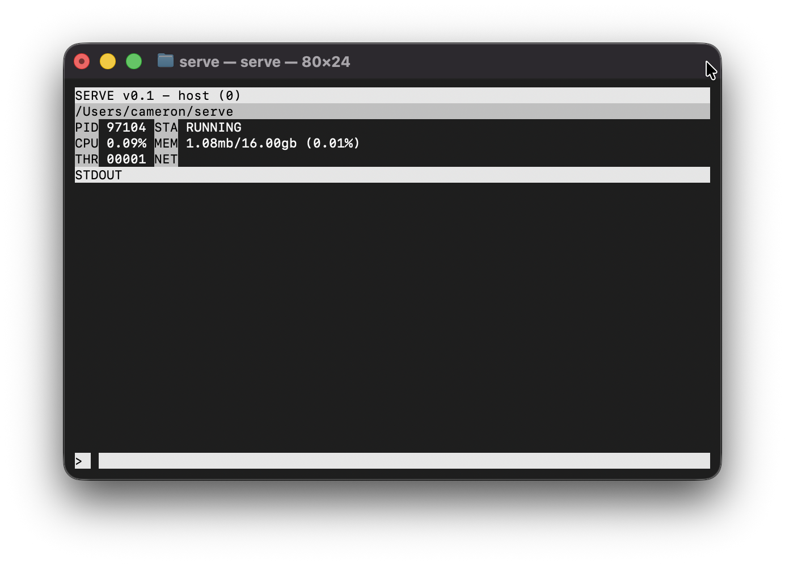

# Serve
Serve is a project used to manage home servers easily and efficiently with a terminal GUI. Currently, it is not easy to use with SSH, but eventually that will change.

## Usage
Serve is used to manage multiple processes at once, showing general information such as CPU and Memory usage, it also comes with a variety of commands.

## Monitoring
There are multiple statistics about a process shown in the screen, which is seen below.

This looks somewhat confusing, but no worries! It's actually quite easy to navigate. Let's start with the top bar, which looks like this: 
`SERVE v0.1 - host (0)`
It shows the SERVE name and it's version, then the currently shown process entry, then the current process entry ID -- The 'host' process is created first and represents serve itself.
Now let's look at the directory right under it, which looks like this:
`/Users/cameron/serve`
This is the CWD (Current Working Directory) of the selected process.
Now let's look at the first row of stats, which looks like this:
`PID 97104 STA RUNNING`
This shows the PID of the selected process and its status. There are various status types, all of which seen below.
- RUNNING
    - Shown when the process is actively running.
- STOPPED CODE
    - Shown when the process has been stopped, along with its exit code.
- SIGSTOP SIG
    - Shown when the process has been stopped by an unhandled signal, along with the code of the signal that caused the exit.
Next, we'll have a look at the second row of statistics, which looks like this:
`CPU 0.095 MEM 1.08mb/16.00gb (0.01%)`
This shows the CPU usage and Memory footprint of the process, the memory footprint is showed in used megabytes out of total system memory and it's percent.
And now, the third line of statistics, which looks like this:
`THR 00001 NET`
This shows the thread count and network usage of the process, however, network usage is yet to be implemented. Once it is implemented it will show the mbps of upload and download used by the app during that check.
Second to last, the STDOUT. This is the STDOUT of the selected program, with everything below it and behind the final white line showing it.
And finally, the input, which looks like this:
`>`
This is the input to serve. Which is, well, where you input commands.

## Commands
For now, there are only 8 commands. All of which shown below with their descriptions. NOTE: If a command outputs text, it will only show in the STDOUT of the host.
### help
Shows a list of commands with brief descriptions.
### create <name>
Create a new process entry named the given name.
### switch <name>
Switches the current process entry to the one with that name.
### list
Lists every active process entry and it's index.
### cwd <directory>
Changes the current process's CWD.
### run <directory> <arguments>
Runs a program at the directory with the arguments.
### kill
Kills the current process.
### del
Deletes the current process entry and switches to host.
### clear
Clears the current processes log.
### quit
Quits serve, kills all active processes.

## Example setup
This is an example on how to create a process entry, change the CWD, and run a process.
Let's say you want to run a python script at /User/foo/py/test.py and python is at /User/foo/py/venv/bin/python3
First and foremost, you want to actually create the entry:
`create python` 
Now that the entry is created, let's switch to it:
`switch python`
Now, we can change the cwd to the root of the script:
`cwd /User/foo/py`
Finally, we can run it like this:
`run venv/bin/python3 -u test.py`
And now it's running with all of it's stats on top!
NOTE: The -u is required to actually see python's STDOUT. If python detects that it's STDOUT is piped, it doesn't like that, -u bypasses the hurdle.